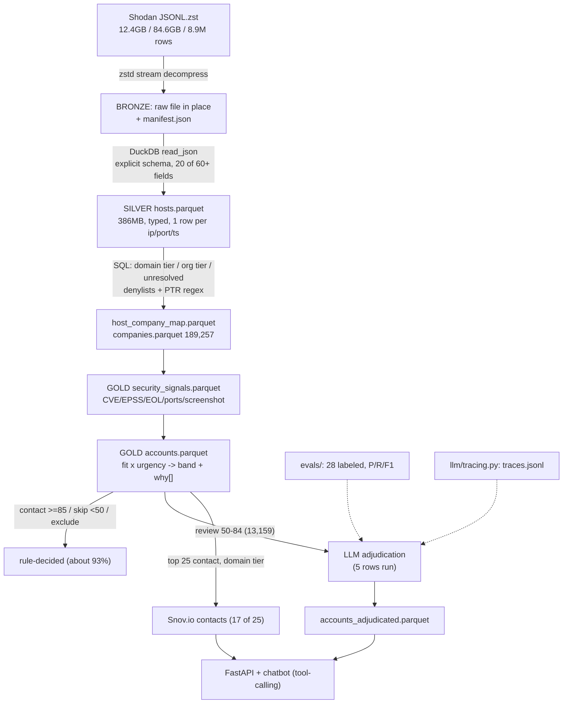
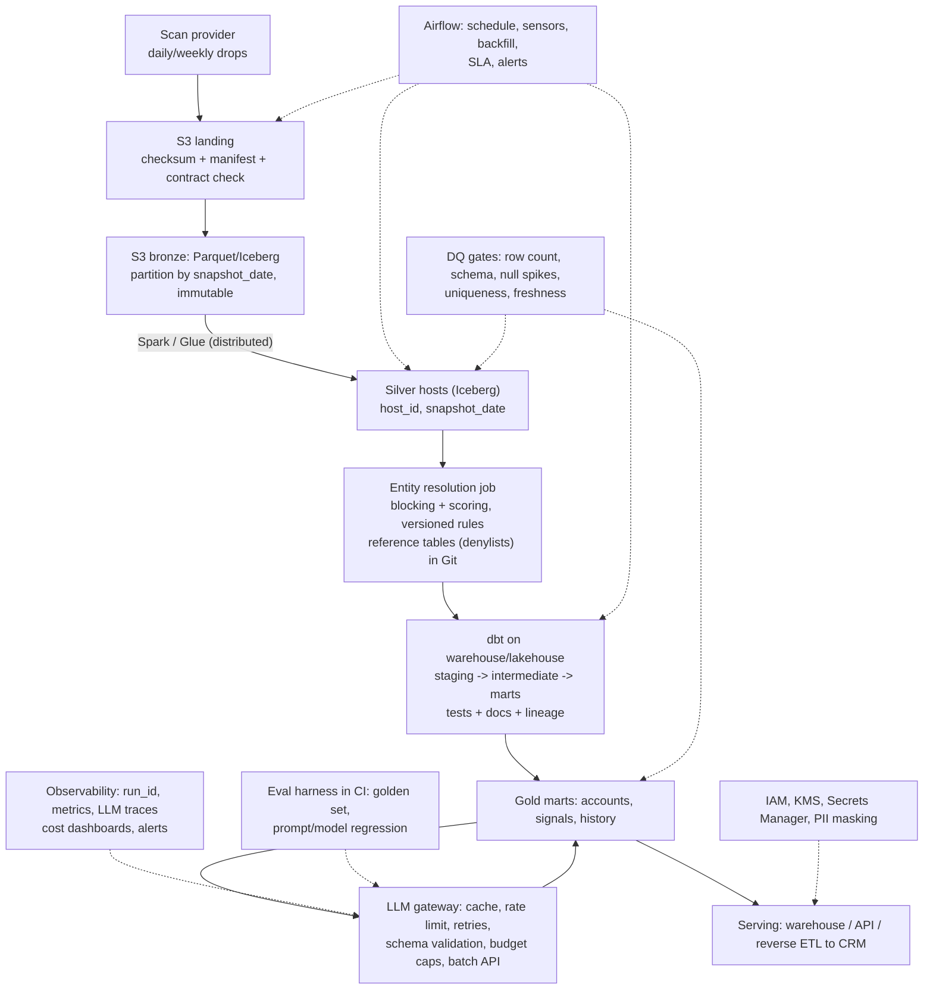

# CyberIntel interview prep, Batch 1: Architecture, Agenda, Slide Plan

Legend: **[BUILT]** implemented and verified in the repo. **[DESIGN]** designed or documented only. **[PROD]** what I would do in production, NOT implemented, do not claim it.

Corrections to carry into every slide (found by checking the data):
- LLM adjudication is wired but only 5 of 13,159 review rows were adjudicated. Do not say the band was adjudicated.
- The 3 few-shot examples in prompt v1 are also in the 28-example eval set (leakage), and the labels follow the same rule the prompt encodes.
- Real LLM usage is about 1.9k input / 0.46k output tokens per call and 12.8 s latency (COST_MODEL.md assumes 600/75 on Claude, which is stale). Serial full pass is about 47 h and about $8. Latency is the bottleneck, not cost.
- The Bronze manifest row count is an estimate and was off by 2x.

---

## 1. Architecture

### A. Diagram 1: what exists today [BUILT]

Everything runs on one machine, orchestrated by hand, no tests.

### B. Diagram 2: production target [PROD]

### C. Component by component

| Component | Why it exists | Alternative | Why this | Trade-off / limit | Failure mode | Production note |
|---|---|---|---|---|---|---|
| Raw file as Bronze, manifest only [BUILT] | Preserve source, avoid a second 84.6GB copy | Parquet mirror of full schema | No disk headroom, 40+ unused device structs | Re-parse 84.6GB JSON if schema needs change | Source file changed or corrupted without detection (manifest has size/mtime, no checksum) | Immutable S3 bronze, snapshot partition, SHA-256 in manifest [PROD] |
| DuckDB + Parquet ZSTD [BUILT] | Out-of-core single-node transform | Spark, warehouse | 85GB fits one node, zero infra, fast iteration | Single node, no HA, no distributed shuffle | OOM on big joins/aggregates (4GB cap set) | Move when: data/day or join state exceeds one node, or SLA needs parallel recovery [PROD] |
| Explicit JSON schema + `ignore_errors` [BUILT] | Skip 40+ unused structs, speed | `read_json_auto` | Auto-detect fails on heterogeneous structs | Silent drops of bad rows | Malformed rows vanish uncounted | Count and quarantine rejects, hard gate on drop rate [PROD] |
| Silver hosts, 1 row per ip/port/ts [BUILT] | Typed flat grain for everything downstream | Keep nested | Avoids repeated JSON parsing | Composite join key (ip,port,ts), NULL ip on 1.2% | Join drops NULL-ip rows (this bug happened) | Surrogate `host_id`, partition by snapshot [PROD] |
| Rules-based ER in SQL [BUILT] | Hosts to companies | Fuzzy/ML matching, vendor registry | Precision over recall, auditable, cheap | Denylists are a floor, no aliases or subsidiaries, no measured accuracy | False merge or false split | Blocking + similarity scoring, golden set, review queue [PROD] |
| Security signals aggregate [BUILT] | Per-company urgency inputs | Compute in scoring | Separates facts from judgments | CVEs are CPE-inferred | Count-type aggregates become NULL or float (this bug happened) | dbt model with tests [PROD] |
| Scoring in SQL [BUILT] | Deterministic rank + `why[]` | ML model | No outcome labels to train on, explainability | Weights uncalibrated | Band thresholds shift volume into review | Calibrate on conversion data, version the weights [PROD] |
| LLM on review band [BUILT, partial] | Judgment where thresholds are weak | LLM everywhere, or rules only | Narrow, measurable, cheap | Eval is small, leaky, rule-circular | Parse failure masked as `escalate` | LLM gateway, structured outputs, run_id, checkpoints [PROD] |
| Tracing JSONL [BUILT] | Call-level audit of cost/latency/decision | Langfuse/OpenTelemetry | Zero setup | No run_id, no error/retry/validation fields | Cannot separate runs or see failures | Add run_id, status, retries, validation_failed, cost dashboards [PROD] |
| Orchestration | None [BUILT = manual] | Airflow, Dagster | n/a | Manual, no retry, no SLA | Forgot a step, stale outputs | Airflow DAG [DESIGN/PROD] |

### D–E. Data lifecycle and Bronze → Silver → Gold

- **Bronze** is the source of truth, immutable. Replay = rerun from Bronze.
- **Silver** is cleaned and typed but not business-interpreted. 8.9M rows, no company concept yet.
- **Silver companies / map** is the interpretation layer where wrong decisions are made (ER). Keep it separate so ER can be rerun without touching hosts.
- **Gold** is per-company facts (signals) and judgments (scores, bands, LLM labels). Facts and judgments are separate tables so the weights can change without recomputing aggregates.
- Lineage today: `host_company_map` plus `why[]`. Missing: run-level lineage, versioned rules.

### F. Batch processing [BUILT]
One-shot full-refresh batch: 5 SQL stages, each reads the previous stage's Parquet. Full recompute on every run.

### G. Incremental / CDC for production [PROD]
Important framing: the source is **full-state snapshots**, not a change stream. True CDC does not apply. What applies is **snapshot diffing**.
- Land each snapshot to `bronze/snapshot_date=...`, partitioned and immutable.
- Silver gets `host_id = hash(ip, port, transport)` and `snapshot_date`. Keep the history table (SCD-2-like: first_seen, last_seen, is_current) or a latest-state table plus history.
- Only compute signals for companies whose hosts changed: diff snapshot N vs N-1 on `host_id`, find affected `company_key`, recompute those.
- LLM re-adjudication only if the account's input hash changed (input-hash cache), which cuts the LLM bill.
- Late or out-of-order snapshots: key by `snapshot_date`, MERGE idempotently.
- Ambiguity to confirm: does the provider send full snapshots or deltas? That decides this design.

### H. Production cloud architecture (AWS-flavored, justify each) [PROD]
- **S3 + Parquet/Iceberg:** cheap, decoupled storage and compute, atomic commits, schema evolution, time travel. Alternative: Delta (Databricks-centric) or plain Parquet (no atomic commits, small-file pain).
- **Spark (EMR/Glue):** needed when state exceeds one node. Alternative: DuckDB on bigger box until about 1-2TB working set, Trino/Athena for SQL-only.
- **Airflow (MWAA):** schedule, retry, backfill, SLA. Alternative: Dagster, Step Functions. Choose per team standard.
- **dbt:** SQL transforms with tests, docs, lineage. Fit: signals, scoring, marts. Not for: ER blocking at scale, LLM calls.
- **Warehouse/lakehouse for serving:** Snowflake/Athena/Redshift, per team.
- **LLM gateway:** one place for caching, budgets, retries, schema validation, tracing.
- **Security:** IAM roles, KMS, Secrets Manager, row/column masking for contact PII.

---

## 2. Agenda: 90 minutes

I changed your split in two ways: moved LLM adjudication into its own block because the JD makes it central, and moved the demo into the middle so the final block is open discussion. Plan for interruptions. A director will interrupt, so 55 min of prepared content with 25 min of buffer is realistic.

| Time | Block | Objective |
|---|---|---|
| 0-5 | Problem, user, why it's hard | Business framing |
| 5-10 | Data and requirements | Scale, shape, success criteria |
| 10-18 | Architecture (Diagram 1) | The mental model |
| 18-28 | Ingestion, Bronze and Silver decisions | Decisions with trade-offs |
| 28-42 | Entity resolution and the 12 bugs | The technical heart |
| 42-48 | Signals and scoring | Facts vs judgment |
| 48-56 | LLM adjudication, eval and tracing | JD-critical, honest numbers |
| 56-62 | Data quality and reliability | What exists, what's missing |
| 62-72 | Live demo | Show, don't tell |
| 72-82 | Scale and production architecture (Diagram 2) | Evolution at 10x/100x/enterprise |
| 82-90 | Business value, gaps, discussion | Honest close |

---

## 3. Slide plan: 22 slides

Format: purpose / on-slide / metrics / key talking points / likely question. Full natural scripts come in Batch 2.

**1. Title.** Purpose: set scope. On-slide: "From scan data to trusted company-level intelligence." Say in one sentence what and for whom.

**2. The business problem.** Purpose: why it matters. On-slide: IP-level scan data → "which company should a rep call today and why?" Talking points: no company column, no contact, no priority. Q: Who used it? Honest: no production users, take-home style, and say so.

**3. The data.** Purpose: scale and shape. Metrics: 12.4GB zst, 84.6GB, 8.9M rows, 60+ fields, one record 25MB. Points: grain is ip/port/timestamp, 73.7% have domains, 99.8% have org, 2.8% have CVEs, 17.5% have product. Q: Why JSONL is hard at scale? A: row-oriented text, no schema, no pushdown, must parse everything.

**4. Three real engineering problems.** On-slide: (1) hosts are not companies, (2) signals are noisy, (3) trust. Frame the story around "converting observations into trustworthy intelligence."

**5. Requirements and success criteria.** On-slide: explainable scores, precision over recall, cost ceiling, rerunnable. Honest: success criteria were defined in PLANNING.md, no business KPIs measured.

**6. Architecture (Diagram 1).** The core slide. Talk through the flow once, then name which parts are rules and which are the LLM.

**7. Why layered.** Bronze/Silver/Gold with the reason for each boundary. Point: companies layer separates interpretation (wrong decisions live here) from facts.

**8. Decision 1: Bronze in place.** Problem: 84.6GB, no disk headroom, 40+ irrelevant structs. Trade-off: reparse cost. Honest add: the manifest estimate was wrong by 2x because length-biased sampling, which is why I trust counts, not estimates.

**9. Decision 2: DuckDB over Spark.** Metrics: 386MB silver (229x smaller), 4GB memory cap, 8 threads. Point: right tool at this scale. Q: When would you switch? (see slide 20).

**10. Silver design.** Explicit projection, typed columns, flags derived from tags, Parquet ZSTD. Cover the 25MB-record bug (`maximum_object_size`). Q: what does `ignore_errors` hide? A: silent drops, which is a gap.

**11. Entity resolution design.** Three tiers diagram: domain 7.5%, org 14.2%, unresolved 78.3%. Point: unresolved is deliberate, not a failure, since most IPs are hyperscaler tenants.

**12. ER failure modes (the bug wall).** Show 4 of the 12 bugs: NULL in `LIKE`, trailing-dot, ISP customers as ISP, brand spoof (amazon.com via PTR). Message: a denylist is a floor, not a ceiling.

**13. ER evaluation: the honest gap.** On-slide: what was done (manual QA sampling) vs what's needed (golden set, P/R/F1, sampled review). Say clearly it isn't measured. Present the evaluation method as design [PROD].

**14. SQL correctness lessons.** NULL three-valued logic (3 bugs), HUGEINT→DOUBLE in Parquet, composite-key collision, refusing "close enough" counts (186,435 vs 187,007). This is your most credible slide.

**15. Signals and scoring.** Fit × urgency, EPSS over CVSS, screenshot override, band thresholds, `why[]`. Honest: weights are hand-set with no outcome data. Facts table vs judgment table.

**16. Rules vs LLM.** About 93% decided by rules, 7% review band to the LLM. Why: auditability and cost. Not an LLM for the threshold cases.

**17. LLM adjudication, eval and tracing.** Metrics: 28 labeled, 78.6% acc, contact P 76% / R 100%, skip R 37.5%. Disclose: leakage, rule-circular labels, n=28. Story: 28 of 43 first-run responses were unparseable (truncation on a reasoning model, masked by an `escalate` fallback), found via traces. Say 5 rows adjudicated so far.

**18. Data quality and reliability.** Table: what exists (QA sampling, count reconciliation, sanity report) vs what's missing (gating checks, atomic writes, quarantine, run_id). Present the planned gate matrix: STOP / QUARANTINE / WARN by check.

**19. Demo.** Transition slide (the plan comes in Batch 4, per the earlier split).

**20. Scale: 9M → 1B → 10B.** Table: DuckDB single-node → bigger node → Spark/Iceberg → partitioned, compacted, incremental. Triggers: working set vs RAM, SLA/recovery time, number of daily snapshots. Cover small files, skew, broadcast joins.

**21. Production architecture (Diagram 2).** Label everything [PROD]. Call out dbt, Airflow, Iceberg, gateway as proposed, not built.

**22. Business value, gaps, close.** What it enables, what I'd fix first (4 items), what I'd learn. Honest: 1.5-2 yrs, strengths = ownership of correctness, judgment on trade-offs.

---

## 4. Open items

1. Run the full silver build once and record the real runtime (README says about 90 s, unverified).
2. Decide whether to fix the 4 code gaps (SQL injection, atomic writes, hard DQ gate, run_id) before the interview.
3. Confirm: is the source full snapshots or deltas?
4. Confirm who wrote what, so I phrase "I" statements correctly.
